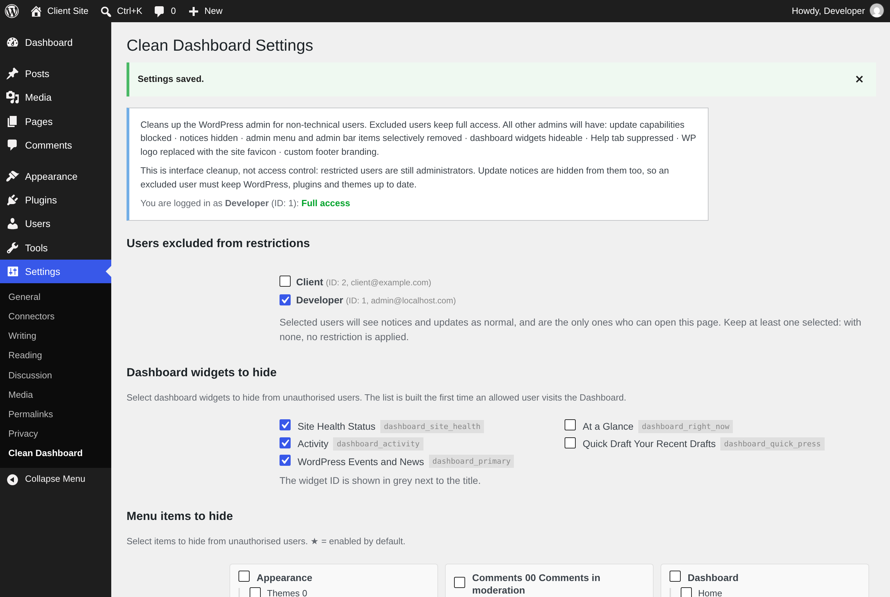
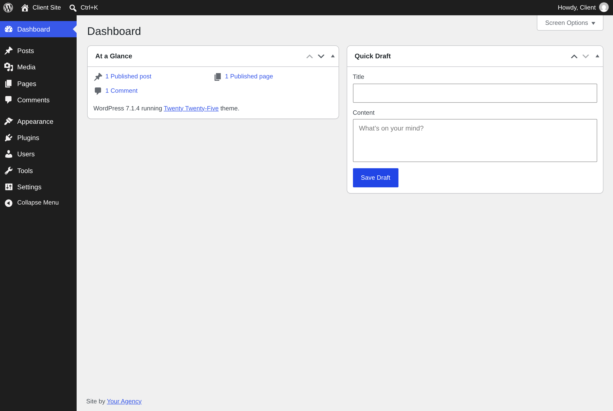

# WP Clean Client Dashboard

A WordPress plugin that cleans up the admin for clients and non-technical users, while one or more designated administrators keep the full, unchanged admin.

You hand over a site, the client logs in as an administrator, and the first thing they see is a wall of plugin notices, update badges, a Theme File Editor and a Customizer they should never open. This plugin hides all of that for everyone except the users you pick, from a single settings page, without touching roles.





## What it does

For every logged-in user who is not on the excluded list:

- **Notices**: all admin notices are removed, or only the ones matching CSS selectors you list.
- **Capabilities**: updating, installing and deleting core, plugins and themes, and the plugin and theme file editors are blocked. The Customizer redirects to the Dashboard.
- **Admin menu**: top-level items and sub-pages you tick are hidden. Updates, Theme File Editor, Site Editor and Customizer are hidden by default.
- **Admin bar**: nodes you tick are removed, on both frontend and backend. The WordPress logo becomes the site icon and links to the frontend (from the admin) or to the dashboard (from the frontend).
- **Dashboard widgets**: widgets you tick are removed.
- **Elementor pages**: on a page with an Elementor layout, the "Edit with WordPress" button is hidden and the switch to the WordPress editor is refused on the server, so the page cannot lose its layout by mistake. A page opened in Elementor and left empty can still be switched back. On by default.
- **Help tab** and the WordPress version in the footer are hidden; the footer text is replaced with your own (links and basic HTML allowed).

The lists of widgets and admin bar nodes are discovered automatically while an excluded user browses the site, so items added by other plugins show up without any configuration.

Settings can be exported and imported as JSON, to reuse the same setup across sites.

## What it is not

This is interface cleanup, **not access control**. Restricted users are still administrators: they can open pages by URL, deactivate this plugin from the Plugins screen, or use any capability the plugin does not block. If someone must not be able to do something, give them a different role, or set `DISALLOW_FILE_MODS` / `DISALLOW_FILE_EDIT` in `wp-config.php`.

Update notices are hidden from restricted users too. Someone on the excluded list has to keep WordPress, plugins and themes up to date, or automatic updates have to be on.

## Safeguards

- **Only excluded users can open or change the settings.** A restricted administrator does not see the page in the menu and gets the standard "not allowed" screen by URL. Changes to the plugin options made by a logged-in restricted user are discarded, whatever the write path (including a crafted POST to `options.php`). WP-CLI and cron, which run without a logged-in user, are not affected.
- **No lockout.** If none of the saved users is an existing administrator (deleted or demoted user, or a database migration that renumbered the users), the plugin restricts nobody and shows a warning to every administrator until the list is saved again. It never locks all administrators out of its own settings. The other side of this: a restricted administrator who deletes or demotes the excluded users switches the restrictions off, which is consistent with this being cleanup, not access control.
- **Sensible first user.** On a new install, the user who activates the plugin becomes the first excluded user. Activated without a user (e.g. `wp plugin activate` without `--user`), the plugin starts unconfigured and asks for the excluded users.

## Requirements

- WordPress 6.0 or later (tested up to 7.1)
- PHP 8.0 or later

## Installation

1. Download the repository as a ZIP, or clone it into `wp-content/plugins/wp-clean-client-dashboard`.
2. Activate **WP Clean Client Dashboard** from the Plugins screen.
3. Go to **Settings > Clean Dashboard**, tick the administrators who keep full access, and save.
4. As an excluded user, visit the Dashboard and a few frontend pages once: this fills the lists of widgets and admin bar nodes you can hide.

## Configuration

Everything is on **Settings > Clean Dashboard**:

| Section | What it controls |
|---|---|
| Users excluded from restrictions | Administrators who keep the full admin and can manage this page |
| Dashboard widgets to hide | Widgets discovered on the Dashboard |
| Menu items to hide | Top-level menus and sub-pages (defaults marked with ★) |
| Admin bar nodes to hide | Nodes discovered on admin and frontend pages |
| CSS selectors to hide | Any element, one selector per line |
| Custom footer text | Footer text shown to restricted users |
| Elementor | Keep restricted users from switching Elementor pages back to the WordPress editor |
| Export / Import settings | JSON snapshot of all the above |

### Filters

```php
// Block more capabilities for restricted users, e.g. plugin activation.
add_filter( 'wpccd_blocked_caps', function ( array $caps ) {
    $caps[] = 'activate_plugins';
    return $caps;
} );

// Keep admin notices, hiding only those matching the CSS selectors in the settings.
add_filter( 'wpccd_hide_all_notices', '__return_false' );
```

## Translations

English strings, with an Italian translation in `languages/`. A `.pot` template is included for other languages.

## Updates

The plugin is not on wordpress.org: it updates itself from the [GitHub releases](https://github.com/bluantinoo/wp-clean-client-dashboard/releases) of this repository, through the bundled [Plugin Update Checker](https://github.com/YahnisElsts/plugin-update-checker) library (MIT). New versions show up in **Dashboard → Updates** and in `wp plugin update`, like any other plugin. The `Update URI` header tells WordPress not to look for this slug on wordpress.org, so a different plugin published there under the same name can never be offered as an update.

Only the zip attached to a release is installed. The site asks the GitHub API for the latest release about every 12 hours. GitHub sees what WordPress sends with every outgoing request: the server's IP address, and the WordPress version and site URL in the User-Agent.

Whoever can publish a release on this repository can ship code to every site that runs the plugin, which is true of any update channel. Releases are built by the workflow in `.github/workflows/release.yml` from a version tag on `main`.

## Uninstall

Deleting the plugin from the Plugins screen removes its options and cached lists.

## License

GPL-2.0-or-later. See [LICENSE](LICENSE).

## Author

[Diego Vagnoli](https://diegovagnoli.it), WordPress and WooCommerce developer.
